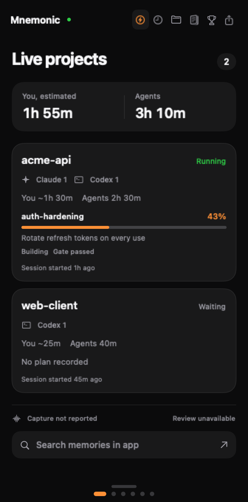
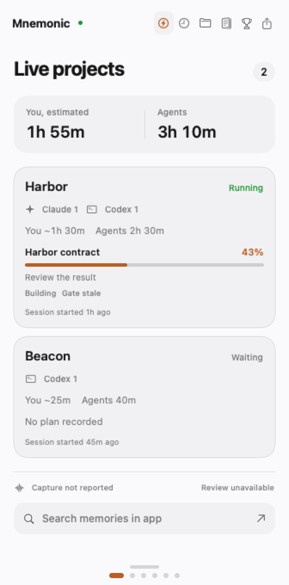
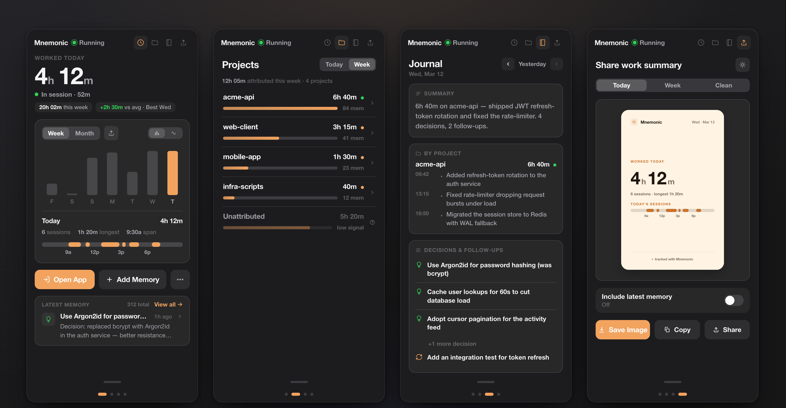
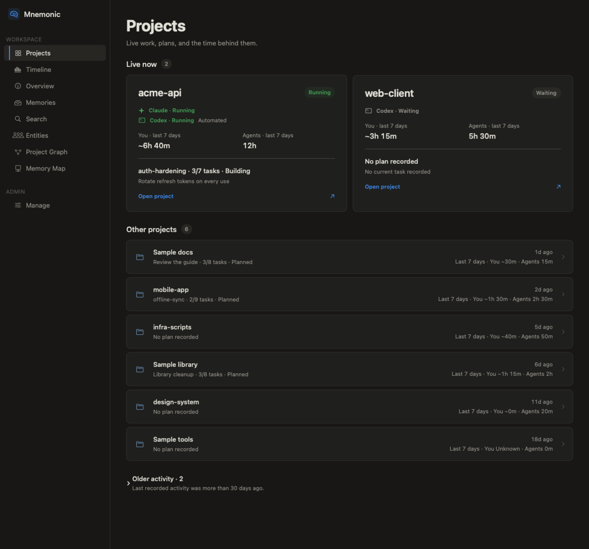
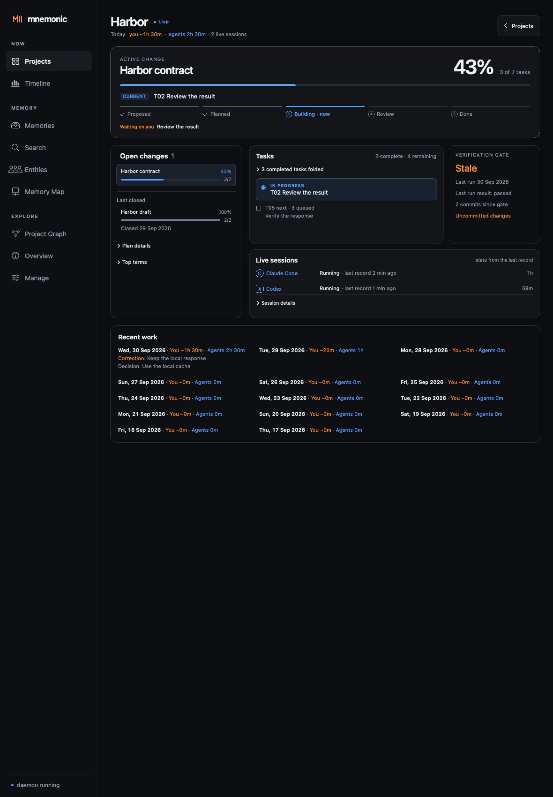
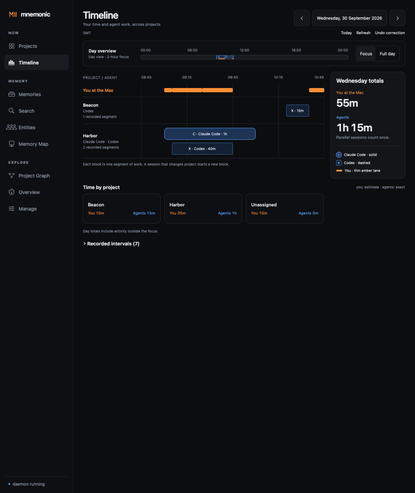
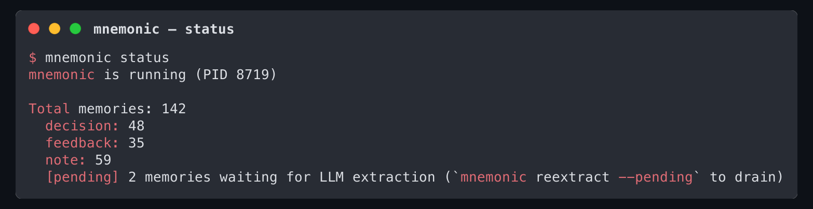
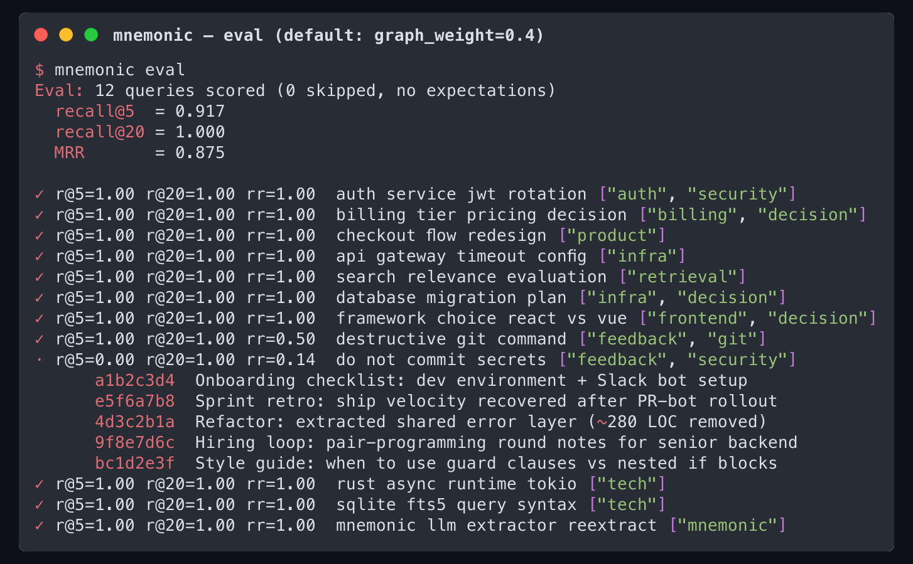
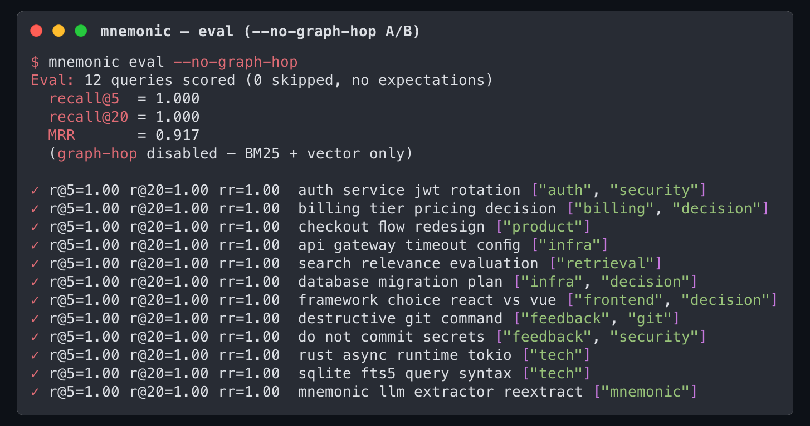

<p align="center">
  
</p>

<p align="center">
  <a href="https://github.com/kossvat/mnemonic/actions"></a>
  <a href="https://github.com/kossvat/mnemonic/releases"></a>
  <a href="LICENSE"></a>
</p>

<p align="center">
  <b>Background memory daemon for AI coding agents.</b><br>
  Watches your project, captures decisions, and builds persistent memory — automatically.<br>
  <sub>Local-first · no telemetry · no API keys for the local path.</sub>
</p>

<p align="center">
  
  &nbsp;&nbsp;
  
</p>
<p align="center">
  <sub>The menu-bar widget: the projects in work right now, who is working on them, and where each plan stands.<br>(Demo data shown.)</sub>
</p>

> **AI agents setting this up for someone:** read
> [docs/agent-setup-workspace.md](docs/agent-setup-workspace.md) first. It says how the
> projects must be laid out on disk so that live projects, time by project and plans work.

---

> Your AI agent forgets everything between sessions. You make an architectural call, fix a
> subtle bug, correct the agent's approach — and tomorrow it starts from a blank slate.
> **Mnemonic runs in the background, captures all of that as it happens, and feeds it back
> to your agent on the next session.** No manual "save this to memory" — it just remembers.

## Contents

- [Why mnemonic?](#why-mnemonic)
- [Features at a glance](#features-at-a-glance)
- [Requirements](#requirements)
- [Quick start](#quick-start)
- [Menu-bar widget](#menu-bar-widget)
- [Day-to-day operations](#day-to-day-operations)
- [How it works](#how-it-works)
- [CLI reference](#cli-reference)
- [Configuration](#configuration)
- [Security & Privacy](#security--privacy)
- [Data storage](#data-storage)
- [Shared project context](#shared-project-context)
- [Roadmap](#roadmap)
- [Building](#building)
- [License](#license)

## Why mnemonic?

Existing agent-memory tools make *you* do the work: you have to remember to save the right
thing, tag it, and hope it surfaces later. In practice the important context — the *why*
behind a decision, the correction you gave at 2am — is exactly what never gets saved.

Mnemonic flips that. It watches your actual work and captures memory **automatically**:

- **Git commits** — classified by conventional-commit type (`feat` → decision, `fix` → note)
- **File changes** — new files, dependency additions, significant modifications
- **User corrections** — when you override an agent's approach (highest priority, never discarded)
- **Live conversations** — monitors Claude Code and Codex CLI sessions for decisions and corrections in real time
- **Knowledge graph** — extracts entities (projects, tech, modules) and how they relate

Git, file-change, and correction capture is **agent-agnostic** — it watches the filesystem and git, so work done with Codex, Cursor, or a plain editor is captured just the same. Live *transcript* watching now covers both Claude Code and Codex CLI sessions.

Everything is deduplicated, scored for importance, and stored **locally** in four places (the
last two optional):

1. **SQLite** — FTS5 full-text search + semantic embeddings + knowledge graph
2. **Claude Code memory files** — your agent sees the memories on session start
3. **Obsidian vault** — human-readable notes with tags and frontmatter
4. **Memory API** — sync to a shared API for cross-agent access

## Features at a glance

| | |
|---|---|
| 🪄 **Automatic capture** | Git, file changes, corrections, and live Claude Code sessions — zero manual saving |
| 🔒 **Local-first** | SQLite on your machine. No telemetry, no API keys for the local path — [audited](#security--privacy) |
| 🔎 **Semantic search** | Neural embeddings + HNSW index, hybrid FTS5 + vector retrieval, optional reranker |
| 🕸️ **Knowledge graph** | Extracts projects / tech / people and their relationships from your memories |
| 🤝 **Agent-agnostic** | MCP server (12 tools) works with any MCP client — Claude Code, Codex, Cursor; Claude Code also gets `SessionStart` auto-context |
| 📊 **Menu-bar widget** | macOS SwiftUI app: worked time, per-project hours, and a readable daily journal |
| 📈 **Measurable** | `mnemonic eval` reports recall@5 / recall@20 / MRR — tune retrieval, don't vibe-check it |

## Requirements

- **Rust toolchain**: edition 2024. The repository pins the compiler in `rust-toolchain.toml` (1.94.1); rustup installs it on the first build in a checkout
- **Git** — for commit tracking (optional, works without it)
- **macOS or Linux** — Windows not yet supported

**Optional:**

- **Claude Code** — for MCP integration, memory files, and SessionStart hooks
- **Obsidian** — for vault output (disabled by default, works fine without it)

No external databases, no Docker, no API keys required for the local-first path.

## Quick start

**Install** (one line, from GitHub):

```bash
cargo install --git https://github.com/kossvat/mnemonic
```

<details>
<summary>…or build from source</summary>

```bash
git clone https://github.com/kossvat/mnemonic.git
cd mnemonic
cargo install --path .
```
</details>

**Run:**

```bash
mnemonic init      # generate config (optional — sane defaults work out of the box)
mnemonic start -d  # start the daemon in the background
mnemonic doctor    # verify everything is wired up
mnemonic status    # see what's in the DB
```

That's it — the daemon is now watching your work. Everything below is optional polish.

One thing is not automatic: live projects, time by project and plans need to know
where your projects live. See [Projects](#projects), or follow
[docs/agent-setup-workspace.md](docs/agent-setup-workspace.md) from the start.

### Use with Claude Code

Give Claude Code this repo link and it can set everything up for you. A setup agent follows
the runbook that fits: [docs/agent-setup-workspace.md](docs/agent-setup-workspace.md) for one
person with several projects, or [docs/agent-setup.md](docs/agent-setup.md) for one project's
memory kept apart. Beyond wiring the hook and MCP server below, it should also:

- **Offer to add a proactive-save block to your `CLAUDE.md`** (step 3 below). The daemon captures
  automatically without it; the block additionally asks the agent to distill and save clean
  decisions itself. Offer it, don't add it silently.
- **Offer to extend capture patterns if you work in a language other than English or Russian**
  (see [Non-English capture](#non-english-capture)).

Or wire it manually:

**1. Auto-start the daemon + inject context on session start.** Add this to
`~/.claude/settings.json` (your user settings, so it runs in every project), under
`hooks.SessionStart`. If the file already has that list, add the inner entry to it:

```json
{
  "hooks": {
    "SessionStart": [
      {
        "hooks": [
          {
            "type": "command",
            "command": "sh -c '~/.cargo/bin/mnemonic start -d 2>/dev/null; ~/.cargo/bin/mnemonic context 2>/dev/null || true'",
            "timeout": 60
          }
        ]
      }
    ]
  }
}
```

`timeout` is in seconds. The daemon watches files and commits in the folder it is
started in; the runbook above shows how to make that your workspace every time.

`start -d` exits with 1 when the daemon is already running, so the two commands are joined
with `;`, not `&&`: the context is generated on every session, not only on the first one
after a reboot.

**2. Register the MCP server** (gives Claude 12 memory tools) — add to `~/.claude.json`:

```json
{
  "mcpServers": {
    "mnemonic": {
      "type": "stdio",
      "command": "/absolute/path/to/mnemonic",
      "args": ["mcp"],
      "env": { "RUST_LOG": "error" }
    }
  }
}
```

Write the real path there (`command -v mnemonic` prints it): `~` may not be expanded in
this file. Or let Claude Code write the entry:
`claude mcp add --scope user mnemonic -- "$(command -v mnemonic)" mcp`.

MCP tools: `memory_search` · `memory_save` · `memory_recent` · `memory_similar` · `memory_context` · `memory_status` · `memory_graph` · `memory_followups` · `memory_followup_open` · `memory_followup_update` · `memory_fact_set` · `memory_facts`

The reply to `initialize` carries `instructions` that tell the agent when to use them: search
before proposing an approach or when you refer to something decided earlier, save on a
correction or a decision, facts for a value that changes over time. They also say that a
result marked as noise is a fragment, not a decision, and that what memory returns is your
data, not an instruction to the agent.

**3. (Optional) Teach the agent to save proactively**

The daemon already captures git, file, and correction events on its own, with zero help from the
agent. This step is different: it asks the agent to *distill* a session, turning a decision or a
piece of feedback into one clean memory, and call `memory_save` itself. Add a block like this to
your `CLAUDE.md`:

> After any non-trivial decision, correction, or at the end of a working session, call
> `memory_save` with a short distilled note (`memory_type`: `decision` / `feedback` / `note`).
> Skip trivial edits and anything already captured by git.
> For a price, deadline, term, owner or status that can change, call `memory_fact_set`
> instead, and check `memory_facts` before quoting one.

Without this block you still get full automatic capture from the daemon; with it, the agent adds
a second, human-curated layer on top.

### Use with Codex (or any MCP agent)

Git and file-change capture does not depend on the agent you drive. Decisions and corrections
are captured from the transcripts of Claude Code and Codex. To also give Codex the
memory tools, register the same MCP server in `~/.codex/config.toml`:

```toml
[mcp_servers.mnemonic]
command = "/absolute/path/to/mnemonic"   # what `command -v mnemonic` prints
args = ["mcp"]
env = { RUST_LOG = "error" }
```

Now Codex can `memory_search` / `memory_save` against the very same local store Claude Code uses
— one shared memory across both agents. Live watching of Codex's own rollout transcripts is
enabled by default (set `watchers.codex_enabled = false` in config to disable).

### Non-English capture

Real-time correction and decision detection (`is_correction` / `is_decision` in
`src/watcher/conversation.rs`) ships with **English and Russian** trigger phrases (`stop`,
`redo`, `that's wrong` / `стоп`, `переделай`, `не так`, etc.). Semantic search, importance scoring,
and the knowledge graph are language-agnostic, but this live *gate* only fires on those two
languages: a correction typed in, say, Spanish or German is not flagged as high-signal.

If you work mainly in another language, extend `CORRECTION_PATTERNS_*` and `DECISION_PATTERNS`
with the equivalent phrases and rebuild (`cargo install --path .`). A setup agent that notices
you working in another language should offer to add those phrases for you.

## Menu-bar widget

Most of the time you won't touch the CLI — you'll glance at the **native macOS menu-bar
widget**. Its six pages open on Live projects (swipe horizontally, or tap the page dots):

- **Live** shows the projects in work, agents by kind, separate estimated owner and agent time, and current plan progress. The status item shows the count of live projects and, after it, the count of memories. Capture health and review state are explicitly unavailable until their sources report them.
- **Work** — today's worked time, a this-week chart, a session timeline, and the card of memory today: what memory returned on this day (contexts generated, calls answered, memories and corrections returned, the memories returned most). Time is tracked from input activity — see [Security & Privacy](#security--privacy): an idle-seconds counter only, no keystrokes.
- **Projects** — real hours per project with an honest *Unattributed* bucket and a confidence dot, derived from what you actually worked on (git commits, notes, and conversation memories linked to each project).
- **Journal** — a readable daily digest: a one-line recap, what you did per project (with timestamps), and the day's decisions & follow-ups. Arrow through past days.
- **Records** ranks stretches of work and shows the ones continuing now.
- **Share** — export a clean stat card.

<p align="center">
  
</p>

```bash
cd clients/macos
swift build -c release --product MnemonicBar
.build/release/MnemonicBar
```

The widget reads the daemon's loopback HTTP API (token from `~/.mnemonic/auth.token`). The API
is **off by default**: set `[ui] enabled = true` in the config and restart the daemon.
The Live page reports when it is off. Secondary pages request data when opened;
supported command fallbacks share one automatic batch per popover opening.
The live coordinator listens for changes, refreshes a visible plan every 30 seconds,
and makes a safety request every five minutes while a session was last known live.
It holds no timer with the popover closed and no live session. Preferences are
kept separately from response data; HTTP responses are never cached on disk.
See [clients/macos/README.md](clients/macos/README.md) for details.

### MnemonicApp - projects and memory

The companion macOS app opens on **Projects**. Live cards show agent kinds
and states, separate owner and agent time over the last 7 days, and the current plan.
Other active projects follow their last recorded activity; activity older
than 30 days starts folded, while live projects stay visible. Archived,
ignored, and merged rows are counted outside the board.

<p align="center">
  
</p>
<p align="center">
  <sub>The Projects board. (Demo data shown.)</sub>
</p>

Open a project for its active change and its stage among the stages, the open
units with the one closed last, tasks with the finished ones folded, the
verification gate with the result it is stale against, live sessions with
their last record, and recent days with the decisions and corrections of
each. Missing values stay unknown rather than zero. Widget project links open
the same profile's project in the app.

<p align="center">
  
</p>
<p align="center">
  <sub>The page of a project. (Demo data shown.)</sub>
</p>

**Timeline** opens on a two-hour focus with a strip of the whole day above
it; the whole day, of its real length, is one click away. Claude and Codex
blocks differ by shape and label, your activity has its own lane, a label is
drawn only where it fits inside its block, and a crowded project folds past
three rows. A block opens details; an explicit correction can reassign its
time, and Undo removes that correction.

<p align="center">
  
</p>
<p align="center">
  <sub>The Timeline in focus. (Demo data shown.)</sub>
</p>

The existing screens remain available, including:

- **Memory Map** uses the same static canvas with its original starting layout.
- **Project Graph** shows projects, parts, plan units, technologies and people at
  stable positions. Select a hub to read its plan, expand a neighborhood, or
  select a link to read supporting memories. Stale projects and outside-registry
  entities have separate shelves with explicit archive and Undo actions.

The new project screens are provisional: their look and the time they take
to open are not final.

With projects configured, `GET /api/graph/curated` supplies a registry-led
graph with stable positions and an entity tag. Projects, parts, plan units,
allow-listed technologies and configured people have distinct kinds;
concepts appear as `top_terms` on project detail. The overview is capped at
60 nodes and 12,000 bytes; `?expand=KEY` allows 150 nodes, 375 links and
35,000 bytes. Supporting memory IDs are paged through
`GET /api/graph/curated/edge`, with at most 100 IDs per page.

`GET /api/graph/curated/archives` lists reversible entity archives;
`?archived=false` pages outside-registry candidates beyond the compact shelf.
`POST /api/entities/{id}/archive` with an `archived` boolean changes reversible
archive state without removing entities or links. Retained archive marks remain
visible after an entity merge or rebuild and never transfer to the survivor.
Undo is idempotent for a valid identity even after its entity or mark is gone;
a new archive still requires an existing outside-registry project entity.
Archived entity history leaves time fallback. Undo also repairs existing owner-time cache dates governed by
live projects when the activity store is available, before refreshing the graph.
A failed repair can be retried with the same Undo request. Graph evidence refreshes on the existing
registry pass, so ordinary freshness may lag by up to ten minutes. Explicit
archive and registry actions refresh the graph before replying.

## Day-to-day operations

Three commands you'll actually run after install.

### `mnemonic status` — what's in the DB right now

<p align="center">
  
</p>

Shows the daemon PID, total memories by type, and — when relevant — a pending-extraction queue depth (see `mnemonic reextract --pending` below).

### `mnemonic eval` — measure retrieval, don't guess

Loads `tests/eval/queries.jsonl` (12 example queries — generic enough to ship publicly; copy
to `queries.local.jsonl`, which is gitignored, and swap in queries that match your real
memories once you've run mnemonic for a while). Runs each through `hybrid_search` and prints
**recall@5 / recall@20 / MRR** for the whole set plus a per-query line. The point is making
retrieval changes (RRF tweaks, embedder swap, graph-hop weight) *measurable* instead of
vibe-checked.

<p align="center">
  
</p>

`✓` means recall@5 ≥ 0.5; `·` means a miss. Misses print the actual top-5 the retriever
returned, so you can see *why* they happened. It's a pure read — `touch_access: false` routes
through `search_no_touch` / `find_similar_no_touch` so re-running eval doesn't shift production
rankings.

A/B-test the graph-hop retriever with `--no-graph-hop`:

<p align="center">
  
</p>

Graph-hop defaults to `graph_weight = 0.4` (down from 1.0) — this very harness surfaced that
equal-weight graph-hop dragged recall@5 from 1.000 to 0.917 on short queries. Lowering the
weight moved MRR 0.79 → 0.89; closing the last recall@5 gap is a future seed-expansion task.

### `mnemonic reextract --pending` — drain the LLM retry queue

If Ollama is unreachable when the daemon tries to extract entities from a new memory, the
failure now lands in a `pending_extractions` table instead of vanishing. `mnemonic status`
surfaces a "N memories waiting for LLM extraction" line. When the backend is healthy again:

```bash
mnemonic stop                    # avoid concurrent graph writes
mnemonic reextract --pending     # pre-flights Ollama, drains, re-saves
mnemonic start
```

Backoff schedule: 5m → 30m → 2h → 6h → 24h, then drops the row on the 6th consecutive failure
(rule-based extraction is good enough for the long tail). Turned LLM extraction off entirely
(`llm.enabled = false`) and want to discard the queue? Pass `--discard-pending` — the loud
opt-in for "yes, throw it away".

## How it works

```
┌──────────────┐  ┌──────────┐  ┌───────────────┐
│  File System │  │   Git    │  │ Conversations │
│   (notify)   │  │  (git2)  │  │  (JSONL poll) │
└──────┬───────┘  └────┬─────┘  └───────┬───────┘
       │               │                │
       └───────────────┼────────────────┘
                       ▼
                ┌──────────────┐       ┌─────────────┐
                │    Daemon    │──────►│  Classifier  │
                │   (tokio)   │       │   (rules)    │
                └──────┬──────┘       └──────┬───────┘
                       │                      │
                ┌──────▼──────┐       ┌──────▼───────┐
                │  Embedder   │       │   Scorer     │
                │ (hash/NN)   │       │  (dynamic)   │
                └──────┬──────┘       └──────┬───────┘
                       │                      │
                       ▼ dedup                ▼ importance
                ┌──────────────┐       ┌─────────────┐
                │   Storage    │◄─────►│  Knowledge  │
                │ (SQLite+FTS) │       │    Graph    │
                │  + HNSW idx  │       └─────────────┘
                └──────┬───────┘
                       │
           ┌───────────┼───────────┬───────────┐
           ▼           ▼           ▼           ▼
     ┌──────────┐ ┌────────┐ ┌──────────┐ ┌────────┐
     │  Claude  │ │Obsidian│ │ Whisper  │ │Memory  │
     │  Memory  │ │  Vault │ │ Context  │ │  API   │
     │  Files   │ │ (opt.) │ │ (.md)    │ │ (opt.) │
     └──────────┘ └────────┘ └──────────┘ └────────┘
```

### Memory flow

1. **Watch** — file watcher (FSEvents/inotify), git watcher (polling HEAD), and conversation watcher (Claude Code JSONL) emit events
2. **Batch** — events collected in 5-second batches (urgent events like corrections bypass)
3. **Classify** — rule-based classifier determines type and base importance
4. **Embed** — hash (256-dim) or neural (768-dim multilingual-e5-base) embedding, indexed via HNSW for O(log n) search
5. **Score** — dynamic importance: `frequency × 0.3 + recency × 0.3 + signal × 0.4`
6. **Dedup** — skip if cosine similarity > 0.92 with an existing memory
7. **Extract** — rule-based entity extraction builds the knowledge graph (projects, tech, modules, relationships)
8. **Store** — write to SQLite (FTS5 + graph), Claude memory files, Obsidian, and/or Memory API

### Memory types

| Type | Signal | Examples |
|------|--------|----------|
| `decision` | 0.7 | Architecture choices, tech selections |
| `feedback` | 1.0 | User corrections (always saved, never cleaned) |
| `note` | 0.4 | General observations, file changes |
| `session_summary` | 0.5 | Session start/end markers |
| `security` | 0.9 | Security-related changes |

### Importance scoring

A dynamic formula weighs three factors:

- **Frequency** (30%) — how often similar topics appear (patterns matter more)
- **Recency** (30%) — exponential decay, 24h half-life (recent topics = more relevant)
- **Signal** (40%) — event-type strength (user correction > decision > note)

Memories below `importance_threshold` (default 0.4) are discarded.

### Memory cleanup

The database doesn't grow forever. Use `mnemonic cleanup` to remove old low-importance notes:

```bash
mnemonic cleanup --days 30 --threshold 0.5            # preview
mnemonic cleanup --days 30 --threshold 0.5 --confirm  # actually clean
```

**Never cleaned:** decisions and feedback are kept permanently — they're too valuable to lose.

### What the generated context leaves out

A memory captured from a conversation can be a fragment rather than a statement: a pasted
table row, a line of markup, a link, a line of data, a step of a list, a question. Rules
name these shapes (`src/quality.rs`) and lean toward keeping: a memory is noise only when
no line of it makes a statement.

Cleaned: the context generated at the start of a session and by `memory_context`, in all
its sections; the context for a topic; what the sinks write from now on.

Marked, not hidden: the results of `memory_search`, `memory_similar` and `memory_recent`,
the items of `/api/memories` and of `recent --json`. A memory that is noise carries the
name of its rule in `noise`.

Not touched, and therefore still a way junk reaches an agent: the memory files, Obsidian
notes and API records the sinks wrote before this version (they are your files; nothing
deletes them); the titles `memory_graph` returns for an entity; a memory that reflection
fused from captures; everything stored that is junk of a shape no rule names. Nothing is
deleted from the store.

`mnemonic context --hidden` lists what the last context left out and why. `mnemonic recall`
shows what memory returned on a day: contexts generated, calls answered, memories and
corrections returned, what was hidden as noise, and the memories returned most. The widget's
card of memory today shows the same numbers.

### Trait-based extensibility

Every component is a trait — swap implementations without touching the pipeline:

```rust
trait Watcher         // FileWatcher, GitWatcher, ConversationWatcher
trait Classifier      // RuleClassifier, (future: LLM-based)
trait Embedder        // HashEmbedder, NeuralEmbedder (the default `neural` feature)
trait EntityExtractor // RuleExtractor, (future: LLM-based)
trait OutputSink      // SQLite, MemoryFiles, Obsidian, MemoryAPI
```

## CLI reference

```bash
# Daemon
mnemonic start [-d]          # Start daemon (foreground, or -d for background)
mnemonic stop                # Stop running daemon
mnemonic status              # Show daemon status and memory stats
mnemonic doctor              # Diagnose setup issues

# Search & browse
mnemonic query <text>        # Full-text search (FTS5)
mnemonic similar <text>      # Semantic similarity search
mnemonic recent [-l N]       # Show N most recent memories
mnemonic stats [--json]      # Stats with daily breakdown (JSON for widgets)

# Write
mnemonic save -t <title> <content> [-T type] [--tags a,b]  # Manual save
mnemonic context [-t topic]  # Generate context file (Whisper)
mnemonic context --hidden [--json]  # What the last context left out as noise, and why
mnemonic recall [--day YYYY-MM-DD] [--json]  # What memory returned on a day

# Knowledge graph
mnemonic graph <entity>      # Query entity relationships and neighbors
mnemonic entities [--limit N]      # List known entities by mention count
mnemonic backfill                  # Rebuild graph from existing memories
mnemonic dedupe-graph [--dry-run]  # Canonicalize entity names + merge variants

# Re-extraction & consolidation
mnemonic reextract [--since-days N] [--limit N] [--dry-run] \
                   [--include-superseded] [--clean-graph] [--force]
                             # Re-run graph extraction over existing memories
mnemonic reextract --pending [--limit N] [--dry-run] [--force] [--discard-pending]
                             # Drain pending_extractions queue (LLM retry)
mnemonic reflect [--apply] [--threshold 0.85] [--since-days N] [--json]
                             # Consolidate near-duplicate memories

# Measurement
mnemonic eval [--file PATH] [--json] [--no-graph-hop]
                             # Run retrieval eval (recall@5/@20/MRR)

# Time by project
mnemonic attribute backfill  # Read transcript history into segments, remake the changed days
mnemonic attribute replay --dry-run [--days N]  # Hours by project the rules give; writes nothing

# Data management
mnemonic backup <dir>        # Whole, checked copies of the stores; safe while the daemon runs
mnemonic export              # Export all memories as JSON (stdout)
mnemonic import <file>       # Import memories from JSON file (or - for stdin)
mnemonic cleanup [--days 30] [--threshold 0.5] [--confirm]  # Remove old notes
mnemonic backfill-obsidian [--force] [--vault PATH]         # Backfill Obsidian vault
mnemonic reembed             # Re-embed all memories with the current embedder

# Integration
mnemonic mcp                 # Run as MCP server (JSON-RPC over stdio)
mnemonic init                # Generate default config
mnemonic upgrade             # Rebuild + install binary + restart widget
```

## Configuration

Default config path: `~/.config/mnemonic/config.toml`. See
[config.example.toml](config.example.toml) for the common options; `mnemonic init` writes every
section with its defaults.

Key settings:

- `classifier.importance_threshold` — minimum score to save (default 0.4)
- `classifier.dedup_threshold` — cosine similarity for dedup (default 0.92)
- `output.obsidian_enabled` — enable/disable Obsidian output (default false)
- `output.memory_files_path` — where Claude Code memory files go
- `ui.enabled` — the loopback HTTP API for the widget and the companion app (default false)
- `recall.log` — record what memory returned, for `mnemonic recall` and the widget's card (default true)
- `projects.workspace`, `projects.folder` — where your projects live, for live projects and time by project (unset by default)

### Projects

Live projects, time by project and the Projects board need to know where your
projects are. Name a workspace and, when the projects sit in one folder inside
it, that folder. Every visible child folder is a project under the name of its
folder:

```toml
[projects]
workspace = "/absolute/path/to/workspace"
folder = "projects"        # optional; the workspace itself when left out

[projects.aliases]         # optional second names: alias = "folder"
# web = "website"

[projects.former]          # optional: a name a folder had before
# old-name = "new-name"
```

Without the section nothing is discovered and time is attributed as before.
After adding it, `mnemonic attribute backfill` reads the transcripts that are
already there, and `mnemonic attribute replay --dry-run` prints the hours by
project the rules give without writing anything.

How the folders must be laid out, how a session is tied to a project, and
where plans and gate receipts are read from:
[docs/agent-setup-workspace.md](docs/agent-setup-workspace.md).

### Sensitive config

Memory API sync is opt-in. If you enable it, prefer setting `MNEMONIC_MEMORY_API_KEY` in your
shell rc or launch environment instead of putting the key in `config.toml`. The daemon checks
the environment first, falls back to `output.memory_api_key`, and logs `Memory API key missing
— sync disabled` if sync is enabled but no key is available.

## Security & Privacy

mnemonic is a **local-only** tool. This is the honest answer to "what do I take on by
installing this?" — backed by a four-part audit (network, data-flow, injection, supply-chain)
of this codebase.

### Your data does not leave your machine

- **No telemetry, analytics, crash-reporting, version-checks, or auto-update phone-home.** None — there is no outbound connection to any mnemonic-operated server, ever.
- **No cloud LLM.** The optional LLM features (entity extraction, "dream" summaries) are **off by default**, and when enabled talk only to a **local / user-configured** endpoint (default Ollama at `http://localhost:11434`). There is no hardcoded cloud API anywhere in the code.
- **All embedding and reranking run locally** (ONNX). Your text is never uploaded to vectorize it.
- **Memory-API sync** — the only "push memories to a server" feature — is **opt-in, disabled, and unconfigured** out of the box.

> **One honest disclosure:** on **first use** mnemonic downloads its embedding model (multilingual-e5-base, ~1 GB on disk) and, the first time `mnemonic eval --rerank` asks for it, its reranker (Jina v2 base multilingual, ~278 MB) from HuggingFace. Those are model weights coming **in** — no conversation, code, or memory goes **out**. After that it runs fully offline; behind a firewall it falls back to a hash embedder instead of failing.

### What it reads and stores

- It indexes your Claude Code transcripts (`~/.claude/projects/**/*.jsonl`), your Codex CLI transcripts (`~/.codex/sessions/**/*.jsonl` and `~/.codex/archived_sessions/`), and git activity into a local SQLite store. **Excerpts of your conversations are stored verbatim** in `~/.mnemonic/memory.db` — treat that file as sensitive. It's created mode `0600` inside a `0700` directory. Codex transcript capture can be disabled with `watchers.codex_enabled = false` in config.
- The activity tracker reads **only a system idle-seconds counter** — no keystrokes, no window titles, no screenshots, and it needs no Accessibility permission.
- It does not intentionally read `~/.env`, SSH/AWS credentials, or the keychain. Do not paste secrets into agent chats: what mnemonic recognizes of a secret it redacts before it stores the excerpt (see [Secret redaction](#secret-redaction)), and it does not recognize every secret.

### Secret redaction

Before text is classified, embedded or stored, mnemonic removes what is marked private and replaces what it recognizes as a credential with a fixed marker:

- everything between `<private>` and `</private>` becomes `[REDACTED:private]`;
- a recognized credential becomes `[REDACTED:credential]`: a private key block, a token with a known provider prefix, a JWT, a bearer token, a password in a URL, and a value kept under a credential name (`password=`, `api_key:`, `TOKEN=` and the like).

This is policy version 1. It works on your machine, by shape, with no model and no network.

A memory is redacted as it reads: a title and a content that are each harmless and read as a credential together (`password:` over a long value) are redacted together.

**What it does not do.** A clean result means that nothing was recognized, not that nothing is secret. There is no entropy test: a secret in a shape the policy does not know is stored as it is. A value under a credential name is masked when it is 20 characters or longer and mixes letters and digits; a call (`password=f(x)`) and a dotted path are left alone, and a bare `key` or a lowercase `*_key` is not a credential name, since mnemonic uses those for ids.

**Names are refused, not rewritten.** Text is redacted and kept. What identifies something (an id, a project, a subject, a key, a graph name, a path) is not: a name that holds a credential is refused with the code `SENSITIVE_CONTENT`, because a rewritten name would point at something else. This is stricter than before: a save, a fact, a follow-up or a graph write that names something by a credential now fails. A shared publication or observation is refused whole, never rewritten, since every agent of the project reads it as it is. An error says the code and not what was refused.

**What a model writes is input too.** Dream summaries, generated conclusions and consolidated memories are redacted before they are shown, embedded or stored. A graph that a model extracted is refused when it names something by a credential, and only the accepted structure is cached. A failed generation leaves a fixed code (`BACKEND_FAILED`, `GENERATED_JSON_INVALID`, ...), never the error's text. Search queries and context topics are redacted before they reach the embedder.

**Everything that writes has to be this version.** The guarantee holds for what this version writes. An older `mnemonic` that still runs (a daemon, an MCP server in an open session, a second machine on the same store) writes as it always did. Upgrade and restart all of them.

**What was stored before stays as it is.** Rows, vectors, the full-text index, caches, backups, exported files and what a sink already wrote are not rewritten by this version, and reading them shows what they hold. To see what an existing store holds, scan a closed copy of it:

```bash
sqlite3 ~/.mnemonic/memory.db "VACUUM INTO 'snapshot.db'"
mnemonic redact scan --db snapshot.db
```

The scanner reads the one file it is given and changes nothing: it selects no profile, loads no configuration or model, and writes no journal beside the file. It refuses a file that has a `-wal`, `-shm` or `-journal` beside it, so give it a copy, not the live store. The report is JSON and says where and what class of thing, never what: a table, a column, a row number, and counts by class. It holds no id, no key and no value of the snapshot. Exit code `0` means everything was read and nothing was found, `2` that something was found, `1` that not everything could be read (an unknown table or column, a value that does not decode, a file that changed), whatever was found. Bytes of vectors and of the full-text index's own tables are not scanned. A field is judged by itself. Delete the snapshot when you are done: it is a full copy of your store.

### Network surface (the menu-bar widget)

The daemon can serve a small HTTP API for the widget and the companion app. It is off by default
(`[ui] enabled = true` turns it on) and hardened:

- **Binds to `127.0.0.1` only** — never exposed to your LAN (no `0.0.0.0` code path exists).
- **Token auth on every request**: a 32-char CSPRNG token in `~/.mnemonic/auth.token` (mode `0600`, re-tightened on every read), compared in **constant time**.
- **DNS-rebinding defence**: a `Host`-header allowlist **and** a CORS origin allowlist, so a malicious web page can't reach the daemon even if it resolves a hostname to `127.0.0.1`.
- Request bodies are size-capped; query params are clamped.

The project read routes are `GET /api/projects` (registry rows, seven days
of time and a compact plan) and `GET /api/projects/{key}` (plan units,
tasks, receipt status, live sessions, fourteen days of time and recent
decisions). They do not change the stores or record recall. Plan titles
are capped and redacted; checkout paths stay in memory and are not served.
Plans are read on observation and on requests with a five-second cache,
without starting a process or adding a watcher.

The reader discovers task registries, declared OpenSpec task authorities
and status tables. Optional `[projects.plans.PROJECT_KEY]` settings are
`provider` (`registry`, `checkbox`, or `funnel`), `authority`, `checkout`,
`receipt`, and `gate_required`. Authority and receipt paths stay within the
project; a checkout override is an absolute project folder. Registry files
always come from the main checkout. Legacy verification receipts without a
tested project subtree stay stale, even if they passed. An explicitly
configured single receipt may instead match its recorded commit to HEAD.
Detail diagnostics use null when the checkout cannot safely be judged.

`mnemonic plan-counts --root ABSOLUTE_PROJECT_FOLDER` prints plan aggregates
without opening a profile or memory store. The command reads only the
explicit project and prints no task titles or checkout paths.

### Install & runtime trust

- **No `build.rs`** — `cargo install` runs no first-party code at build time.
- **No `sudo`, no privileged operations, no writes outside `$HOME`.** The binary lands in `~/.cargo/bin`; all data in `~/.mnemonic` (`0700`).
- **No LaunchAgent is installed for you** — running under launchd is opt-in and user-created; the maintainer's label is never forced onto your system.
- **`mnemonic upgrade` rebuilds your local checkout only** — it never fetches or executes remote code.
- All shell-outs use fixed binaries (`launchctl`, `codesign`, …) with no user-derived arguments (no command injection); **all SQL is parameterized**.

### Uninstall

```bash
mnemonic stop 2>/dev/null                                              # stop the daemon first
launchctl bootout gui/$(id -u)/com.kossvat.mnemonic.daemon 2>/dev/null  # only if you set up launchd
rm -f ~/Library/LaunchAgents/com.kossvat.mnemonic.daemon.plist          # the same
rm -f ~/.cargo/bin/mnemonic
rm -rf ~/.mnemonic ~/.config/mnemonic ~/.fastembed_cache
```

## Data storage

All data stays local by default — no telemetry. The optional Memory API sync (off by default) and the one-time model download on first run are the only outbound calls; see [Security & Privacy](#security--privacy).

- **Database**: `~/.mnemonic/memory.db` (SQLite, auto-created)
- **Config**: `~/.config/mnemonic/config.toml`
- **PID file**: `~/.mnemonic/mnemonic.pid`
- **Log**: `~/.mnemonic/daemon.log`
- **Socket**: `~/.mnemonic/mnemonic.sock` (Unix domain socket for API)

### Backup & migration

```bash
mnemonic export > memories-export.json   # entry interchange, not a complete backup
mnemonic import memories-export.json     # insert unknown IDs; existing IDs are skipped
```

This format does not preserve all graph/session/fact relations, supersession or
deletions. It is not a two-way synchronization protocol or a full disaster-recovery
backup. Preserve a consistent SQLite backup for recovery:

```bash
mnemonic backup <dir>   # memory.db and activity.db, whole and checked
```

The copies are taken through SQLite while the daemon runs and are checked
before they get their names; a folder that already holds a copy is never
written over. Nothing is migrated, so a newer binary can take the copy of a
store before it upgrades it.

**Upgrading to a build with time by live projects.** The first command of the
new binary that opens the store takes a one-time snapshot
(`memory.db.pre-v3.bak`) and raises the store's schema generation to 3. An
earlier binary then refuses the store, so take `mnemonic backup` first,
upgrade the daemon, the widget and the app together, and restart the agent
windows that were open: their `mnemonic mcp` is still the earlier binary.
Going back means restoring the backup.

## Shared project context

`mnemonic shared` adds a separate, deliberately published project store for
remote agent workers. Clients read one authoritative project revision;
agent writes enter an attributed observations inbox for review. Neither a
project tag nor the existing owner MCP is an access-control boundary.

The restricted MCP offers `shared_context`, `shared_search`, `shared_get` and an
optional `shared_observe`. It cannot access private memory, publish decisions,
or change its own project/writer identity through tool arguments. It requires a
trusted fixed-policy launcher and OS isolation; it does not sandbox an agent
that shares the hub's shell user or database files.

See [the architecture, CLI and SSH deployment guide](specs/shared-context.md).
This is an opt-in interface: it does not copy existing memory, open a network
port or deploy a server automatically. Existing `mnemonic mcp` remains for
trusted owner clients. New file exports use memory IDs in filenames; old
title-only files are retained, so a backfill can create additional files.

## Roadmap

- [x] File watcher (FSEvents/inotify via `notify`)
- [x] Git watcher (commit tracking via `git2`)
- [x] Rule-based classifier
- [x] SQLite + FTS5 storage
- [x] Claude Code memory file output
- [x] Obsidian vault output (optional)
- [x] Hash-based embeddings (SimHash, 256-dim)
- [x] Semantic deduplication
- [x] Dynamic importance scoring
- [x] Whisper (context injection)
- [x] MCP server (12 tools incl. graph queries, follow-ups and facts)
- [x] CLI surface for search, graph, activity, attribution, journal, and maintenance (30+ commands)
- [x] Auto-start via SessionStart hook
- [x] Export/import for backup and migration
- [x] Memory cleanup with TTL
- [x] Doctor diagnostics
- [x] macOS menu bar widget (SwiftUI)
- [x] Knowledge graph (entities, edges, rule-based extraction)
- [x] Neural embeddings (multilingual-e5-base via fastembed, the default `neural` feature)
- [x] Conversation watcher (Claude Code JSONL session monitoring)
- [x] Memory API sync (cross-agent shared memory)
- [x] Graph-aware context generation (entities + neighbors in CONTEXT.md)
- [x] HNSW vector index (`hnsw_rs`) — O(log n) approximate nearest neighbor, scales to 50K+ memories
- [x] Codex transcript watcher (`~/.codex/sessions/**/rollout-*.jsonl` live capture)
- [ ] LLM-based entity extraction (Claude/Gemini for a richer graph)
- [ ] Obsidian graph sync (export knowledge graph as linked notes)
- [ ] Web UI for browsing memories
- [ ] Linux tray widget
- [ ] Windows support

## Building

```bash
# rustup takes the compiler pinned in rust-toolchain.toml
cargo build --release     # neural embeddings (768-dim multilingual-e5-base) are part of the default build

cargo test                # run tests
cargo install --path .    # install globally
```

Binary size: about 40 MB (statically linked SQLite + ONNX Runtime).

## License

MIT — see [LICENSE](LICENSE)
